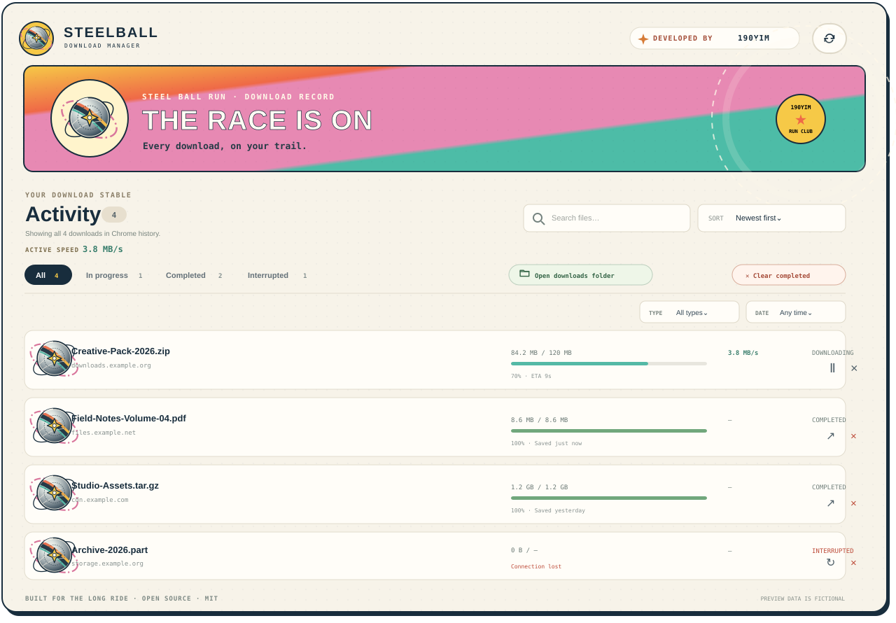
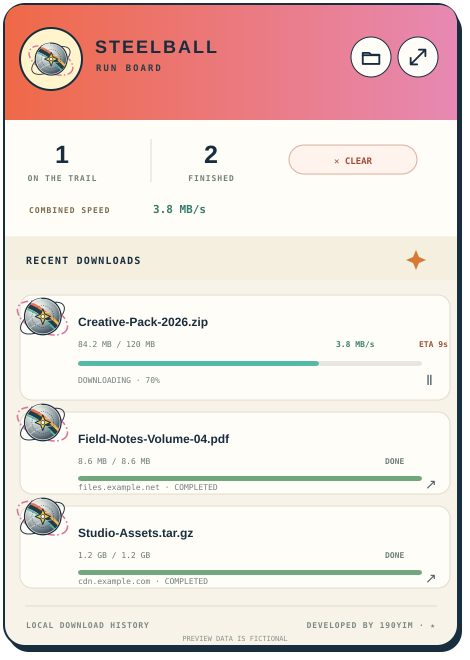

<div align="center">
  
  <h1>SteelBall Download Manager</h1>
  <p><strong>Put your downloads in motion.</strong><br>A colorful, retro-inspired download dashboard for Chrome.</p>
  <p></p>
</div>

<p align="center">
  
</p>

## A better view of your downloads

SteelBall organizes the downloads Chrome already manages in a compact toolbar popup and a full dashboard. Its colorful race-inspired look is built around an original spinning steel-ball emblem.

<p align="center">
  
</p>

### What it can do

- Track active downloads, including progress, estimated speed, and remaining time.
- Pause, resume, cancel, or retry downloads when Chrome supports the action.
- Search and filter history by status, file type, or date; sort by name, size, and time.
- Reveal a completed file in your computer's file manager.
- Clear completed history records without deleting the downloaded files.
- Open Chrome's default Downloads folder from the popup or dashboard.
- Use the compact popup for quick checks, or expand it into the full dashboard.

## Install in Chrome

1. Download this repository and unzip it if needed.
2. Open `chrome://extensions`.
3. Turn on **Developer mode**.
4. Choose **Load unpacked** and select the project folder containing `manifest.json`.
5. Pin the SteelBall icon in the toolbar to open the compact popup.

The extension requires Chrome 96 or later. It is designed for Chrome; behavior in other Chromium-based browsers may vary.

## Permission and privacy

SteelBall requests only Chrome's `downloads` permission. Chrome requires it to show download history and provide controls such as pause, resume, cancel, and reveal in folder.

Download names, URLs, progress, and actions stay in the browser. SteelBall has no account, analytics, tracking, or backend, and does not send download history to the developer or another service. Chrome itself connects to the download source and applies its own cookie and security behavior.

**Clear completed** removes completed entries from Chrome's history. It does not delete the files from your device.

## Development

The extension uses plain HTML, CSS, JavaScript, and bundled SVG/PNG assets; there is no build step or remote font dependency. To edit the toolbar artwork, update `assets/steelball-mark.svg`, then run:

```sh
python3 assets/generate_icons.py
```

See [CONTRIBUTING.md](CONTRIBUTING.md) for contribution guidelines and [LICENSE](LICENSE) for the MIT license.

## Artwork and credits

The steel-ball illustrations and interface are original project artwork. SteelBall is a fan-inspired visual theme and is not affiliated with or endorsed by *JoJo's Bizarre Adventure* or its rights holders. It does not include official character art, logos, or other franchise assets.

Developed by [190yim](https://github.com/190yim).
